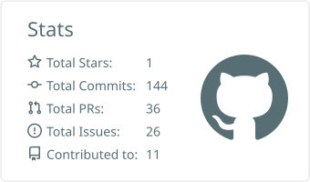
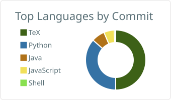

## Hi, I'm Natik

I'm in Class 12 in Bilaspur, India, applying to read Law for 2027 entry. Alongside that I'm teaching myself AI engineering the only way that sticks for me: by shipping real things. Each project takes on one skill I didn't have before, from deploying an LLM app to building evals to writing real-time audio code, and each one goes out with tests and an honest list of what it can't do yet.

**Round 1 qualifier, Meta PyTorch OpenEnv Hackathon with Scaler School of Technology** (April 2026): one of roughly 800 teams to reach the finale from over 31,000 registrations.

### Now building: Riffhouse

I play guitar, and every good amp sim I tried wanted money, an audio interface or an afternoon of driver setup. So I'm building **[Riffhouse](https://github.com/NatikChhabra/riffhouse)**, a guitar amp and pedalboard for your computer that is free for good. Plug your guitar into whatever you have, even a laptop's mic jack, strum for twenty seconds while it sets itself up, and play.

It has 11 amps, 9 cabinets, 29 pedals and 177 tones sorted by genre, and it loads neural amp captures (`.nam`). Every take is also saved as the clean guitar, so you can change the tone after you've played. There's a tuner, a looper, play-along that slows a song down without changing its pitch, and MIDI foot control. The sound engine is C++ on JUCE, adds about 0.1 ms of delay, and runs 5,400 automatic checks on every change. No account, no ads, no paid tier, ever. Music should be free.

Test builds for Windows are out now and the first public version is close. [**See it on GitHub&nbsp;&rarr;**](https://github.com/NatikChhabra/riffhouse)

### Research

**[Sounding Like Which AI? Machine-Style Overlap of arXiv Abstracts with Language Models of Different Vintages](https://github.com/NatikChhabra/Sounding-Like-Which-AI)**, preprint, 2026. [Paper DOI 10.5281/zenodo.23344296](https://doi.org/10.5281/zenodo.23344296), [code and data](https://doi.org/10.5281/zenodo.23343987).

How much of today's writing "sounds like AI", and *which* AI? Across 131,448 arXiv abstracts from 2015 to 2026, the share
that a style classifier places on the AI side of the line rose from 9.2% before ChatGPT to 44.7% in 2026. The
resemblance to most AI models rises and then falls, and newer models tend to peak later, so studies that measure
against a fixed set of models will see the trend "fade" too early.

Run on one home PC against 19 language models (12 of them open models run locally), and carried out with Claude as a fully disclosed AI research
agent. [**Code, pipeline and paper&nbsp;&rarr;**](https://github.com/NatikChhabra/Sounding-Like-Which-AI)

### Other things I've built

| Project | What it is | Stack |
|---|---|---|
| **[RTI&nbsp;Sahayak](https://github.com/NatikChhabra/rti-sahayak)** | Over 53,000 RTI complaints were returned in a single year for avoidable mistakes. Type what you want to know in English or Hindi, and Gemini drafts a proper RTI. A rule checker flags 15 common mistakes (each citing the Act) and also judges the AI's draft, and a deadline calculator drafts your appeal. Evaluated on a held-out set and on 15 real-world needs. [**Live&nbsp;demo&nbsp;&rarr;**](https://huggingface.co/spaces/Natik22may/rti-sahayak) | Python, Gemini API, Gradio, evals |
| **[DPDP&nbsp;Notice&nbsp;Eval](https://github.com/NatikChhabra/dpdp-notice-eval)** | Can AI models write a privacy notice that follows India's new data protection law? 24 made-up Indian businesses, 11 checks each cited to the DPDP Act or Rules, and an LLM judge that was tested against held-out known answers and hand-labelled real notices before it was trusted. None of the four small models wrote a fully compliant notice; a larger one does much better once it is told the law. Paste any notice into the demo to get it checked. [**Live&nbsp;demo&nbsp;&rarr;**](https://huggingface.co/spaces/Natik22may/dpdp-notice-check) | Python, Gemini API, LLM-as-judge, evals |
| **[LexCrisis](https://github.com/NatikChhabra/LexCrisis)** | An OpenEnv reinforcement-learning benchmark that trains agents to run legal operations: conflict-safe client intake, privilege review under litigation pressure, and litigation incident command, all scored by deterministic verifiers. My Meta hackathon submission. [**Live&nbsp;demo&nbsp;&rarr;**](https://huggingface.co/spaces/Natik22may/LexCrisis) | Python, PyTorch, FastAPI, Docker |
| **[claude-arsenal](https://github.com/NatikChhabra/claude-arsenal)** | Ten Claude Code plugins and 66 skills I use every day: a design standard with its own checkers, a YouTube creator pipeline, video editing, a board-exam study system, music, marketing, research publishing, legal prep and my own working rules. | Python, Markdown, Claude Code |
| **Video pipeline** (private) | The system behind a gaming channel I run: raw footage in, edited video, Shorts, captions and thumbnails out, with a QA gate that refuses any render that fails its checks. | Python, FFmpeg, Whisper |
| **[Run&nbsp;Addict](https://github.com/NatikChhabra/Run-Addict)** | A mobile-first PWA for verified running challenges, with Strava OAuth sync, anti-cheat review, leaderboards, rewards and an admin fulfilment console. [**Live&nbsp;&rarr;**](https://natikchhabra.github.io/Run-Addict/) | JavaScript, PWA, Strava API |
| **[homelab](https://github.com/NatikChhabra/homelab)** | The config for my home server: 26 containers (media, music, photos, passwords, budgeting, DNS filtering, monitoring), 15 scheduled jobs with heartbeat alerts, a 135-check weekly audit, nightly verified backups and a pre-commit secret scanner. It also keeps my whole music library synced to my phone for offline listening. | Docker, Bash, PowerShell, Python |
| **[ElderGuard](https://github.com/NatikChhabra/-sentinel-Elderguard)** | An Android safety app for elderly people living alone: accelerometer fall detection, emergency alerts and medication tracking. Built for Stonehill Techno Fest 2026. | Java, Android |

### What I care about

The parts of the legal system that are really systems problems: cost, speed and access to justice. Legal help is too slow and too expensive for most of the people who need it, and that is as much an engineering problem as a legal one. The same idea runs through Riffhouse: good tools shouldn't depend on what you can pay.

### Stack

### GitHub stats

<picture>
  <source media="(prefers-color-scheme: dark)" srcset="https://raw.githubusercontent.com/NatikChhabra/NatikChhabra/main/profile-summary-card-output/tokyonight/3-stats.svg"/>
  <source media="(prefers-color-scheme: light)" srcset="https://raw.githubusercontent.com/NatikChhabra/NatikChhabra/main/profile-summary-card-output/default/3-stats.svg"/>
  
</picture>
<picture>
  <source media="(prefers-color-scheme: dark)" srcset="https://raw.githubusercontent.com/NatikChhabra/NatikChhabra/main/profile-summary-card-output/tokyonight/2-most-commit-language.svg"/>
  <source media="(prefers-color-scheme: light)" srcset="https://raw.githubusercontent.com/NatikChhabra/NatikChhabra/main/profile-summary-card-output/default/2-most-commit-language.svg"/>
  
</picture>

<picture>
  <source media="(prefers-color-scheme: dark)" srcset="https://streak-stats.demolab.com?user=NatikChhabra&hide_border=true&theme=tokyonight"/>
  <source media="(prefers-color-scheme: light)" srcset="https://streak-stats.demolab.com?user=NatikChhabra&hide_border=true&theme=default"/>
  
</picture>

<picture>
  <source media="(prefers-color-scheme: dark)" srcset="https://raw.githubusercontent.com/NatikChhabra/NatikChhabra/output/github-snake-dark.svg"/>
  <source media="(prefers-color-scheme: light)" srcset="https://raw.githubusercontent.com/NatikChhabra/NatikChhabra/output/github-snake.svg"/>
  
</picture>

